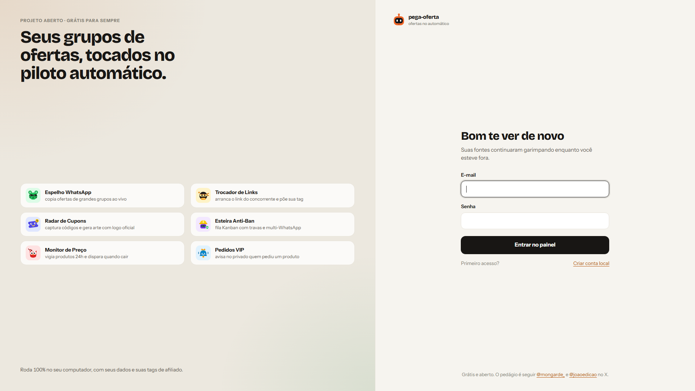

<p align="center">
  <picture>
    <source media="(prefers-color-scheme: dark)" srcset="docs/logo-escuro.png">
    
  </picture>
</p>

<p align="center">Grupo de ofertas no piloto automático: garimpa, troca o link pela sua tag e dispara no WhatsApp.</p>


## Pedágio

O Pega Oferta é grátis para sempre. O pedágio é outro, e não custa nada:

1. Seguir o **[@mongarde_](https://x.com/mongarde_)** no X.
2. Cadastrar o seu projeto no ranking do **[mamaevireidev.com.br](https://mamaevireidev.com.br)**.
3. Dar uma força ao **[Clara Finance](https://github.com/cesaroeduardo/clara-finance?utm_source=mamaevireidev&utm_medium=ranking&utm_campaign=clara-finance&mvd_cid=zVTQdltE9CLQS7Yf)**, projeto de um amigo (uma estrela já ajuda).
4. Seguir o **[@joaoedicao](https://x.com/joaoedicao)** no X.

Dentro do sistema, a seção **Pedágio** tem os mesmos links.

Motor de grupo de ofertas completo, aberto e grátis. Você baixa, roda no seu computador ou numa VPS e liga as suas próprias contas de afiliado:

- **Fontes** — 10 fontes gratuitas do Brasil (Promobit, Canaltech, Adrenaline, Tecnoblog…) ligadas em 1 clique, mais qualquer feed RSS. Coleta a cada 20 segundos.
- **Espelho** — escuta grupos de ofertas do WhatsApp que você já participa, arranca o link do concorrente e põe a sua tag.
- **Ofertas** — cada oferta chega com foto, preço, desconto e cupom. Repetida não entra (3 camadas: código do produto, URL e título).
- **Troca de link** — Amazon, Mercado Livre, Shopee, AliExpress e Awin. Cola qualquer link e ele sai com a sua comissão.
- **Disparo** — WhatsApp por QR code (Baileys, vários números), Telegram e vitrine pública. Editor da mensagem com 13 variáveis e prévia no estilo balão do WhatsApp.
- **Radar de Cupons** — guarda os cupons que aparecem nas ofertas e avisa quando expiram.
- **Monitor de Preço** — cola um link e o preço que quer pagar. Bateu, a oferta entra pronta.
- **Pedidos VIP** — quem pede um produto no seu privado ("quero air fryer até 300") é avisado quando a oferta aparece.
- **API** — tudo que importa um agente (Claude Code, n8n, Make, OpenBot) faz por `/api/v1`.

Nada de tag minha aqui dentro: cada pessoa cola as dela no painel, e tudo fica no seu banco local.

<p align="center">
  
</p>

---

## Começar em 3 comandos

Precisa do [Node.js 22.5+](https://nodejs.org) (Mac, Windows ou Linux). O banco é SQLite nativo do Node, não precisa instalar nada além disso.

```bash
git clone https://github.com/matheusmongarde/pega-oferta.git
cd pega-oferta
./instalar.sh        # no Windows: instalar.bat (ou dois cliques nele)
```

O instalador baixa as dependências do painel e do WhatsApp, sobe tudo e abre **http://localhost:3000/instalar**. Lá você cria a sua conta e segue, um passo por vez: **WhatsApp** (QR code), **Afiliados** (suas tags), **Fontes BR** (1 clique) e **Pronto**. Todo passo tem **pular por agora**: dá para ligar depois.

> Prefere na mão? `npm install`, depois `cd servicos/whatsapp && npm install && cd ../..` e `npm run tudo`.

Da próxima vez, é só `npm run tudo` dentro da pasta.

## Como a oferta anda

```
fonte / grupo espelhado  →  limpa o texto  →  troca o link pela sua tag  →  barra repetida
        →  Ofertas (nova → aprovada → enviada)  →  WhatsApp · Telegram · Vitrine
```

- O coletor roda sozinho a cada 20 segundos. Para puxar na hora: **Ofertas → Sincronizar agora**.
- O **Piloto Automático** (em Esteira & Fila) dispara as aprovadas no intervalo que você escolher, respeitando limite por dia e horário.
- Comece em **modo teste**: nada sai de verdade, o envio fica registrado como simulado. Desligue em **Esteira & Fila** quando estiver pronto.

## Tags de afiliado

| Loja | Onde a tag entra | Exemplo |
| --- | --- | --- |
| Amazon | `tag` | `seunome-20` |
| Mercado Livre | `matt_tool` / `matt_word` | o código do seu painel de afiliado |
| Shopee | ID de afiliado | `an_123456789` |
| AliExpress | ID do portal | — |
| Awin | Publisher ID | — |

Cole em **Contas de Afiliado**. Não sabe qual é a sua? Gere um link no portal da loja e cole no **extrator**: ele acha a tag sozinho.

## Agentes e API

1. **Conexões → API do Sistema & Tokens → Novo token** (um por agente).
2. Use sempre o header `Authorization: Bearer po_live_...`.

| Método | Rota | Faz |
| --- | --- | --- |
| `GET` | `/api/v1/status` | saúde da operação, WhatsApp conectados e contadores |
| `GET` | `/api/v1/grupos` | grupos do WhatsApp conectados |
| `GET` / `POST` | `/api/v1/ofertas` | lista ou manda ofertas novas para o catálogo |
| `POST` | `/api/v1/disparar` | dispara uma oferta nos grupos escolhidos |
| `GET` / `POST` | `/api/v1/cupons` | lista ou cadastra cupons no Radar |

## Subir em produção

### VPS (Ubuntu/Debian)

```bash
./instalar.sh                    # instala e sobe uma vez para criar a conta
npm run build
npm i -g pm2 && pm2 start "npm run tudo" --name pega-oferta && pm2 save
```

Coloque o domínio em `NEXT_PUBLIC_APP_URL` (copie `.env.example` para `.env`) para os links curtos e a vitrine saírem com o endereço certo.

### Docker

```bash
docker compose up -d --build
```

O WhatsApp por QR precisa de uma máquina ligada o tempo todo: seu computador ou uma VPS.

## Comandos

| Comando | Faz |
| --- | --- |
| `./instalar.sh` / `instalar.bat` | instala tudo e abre a instalação no navegador |
| `npm run tudo` | painel + WhatsApp + coletor de 20s + piloto automático |
| `npm run dev` | só o painel, em desenvolvimento |
| `npm run build && npm start` | painel em produção |
| `npm run typecheck` | confere os tipos |

## Problemas comuns

- **WhatsApp não gera QR (npm 11 bloqueando scripts):** dentro de `servicos/whatsapp`, rode `npm approve-scripts --allow-scripts-pending` e `npm install` de novo.
- **`node:sqlite` não encontrado:** o Node está velho. Precisa ser 22.5 ou mais novo (`node -v`).
- **Nenhuma oferta chegando:** veja se tem fonte ativa em **Fontes & Espelho** e clique em **Ofertas → Sincronizar agora**.
- **Link saindo sem a sua tag:** a tag da loja está vazia em **Contas de Afiliado**.
- **Começar do zero:** pare o sistema e apague a pasta `dados/`. Para desconectar o WhatsApp, apague `servicos/whatsapp/.sessao*`.
- **Logo:** os arquivos ficam em `marca/` (símbolo em SVG) e `docs/` (PNG claro e escuro).

## Privacidade

- Tudo fica na pasta `dados/` (SQLite) e as sessões do WhatsApp em `servicos/whatsapp/.sessao*`. As duas estão no `.gitignore`.
- Senha com `scrypt` e sessão em cookie `HttpOnly` assinado.
- Nenhum dado, token ou link de afiliado vai para servidor de terceiro.

## Estrutura

```
src/app/(painel)    telas do painel
src/app/instalar    instalação guiada (conta, WhatsApp, afiliados, fontes)
src/app/api/v1      API dos agentes
src/lib             regras: coletor, parser, troca de link, disparo, banco
servicos/whatsapp   WhatsApp por QR code (Baileys), disparo e espelho
extensao-chrome/    extensão para capturar oferta direto da loja
scripts/tudo.mjs    sobe tudo junto + coletor de 20s + piloto
```

MIT. Use, mude, venda o seu grupo com ele. Só não esquece de seguir o [@mongarde_](https://x.com/mongarde_).
